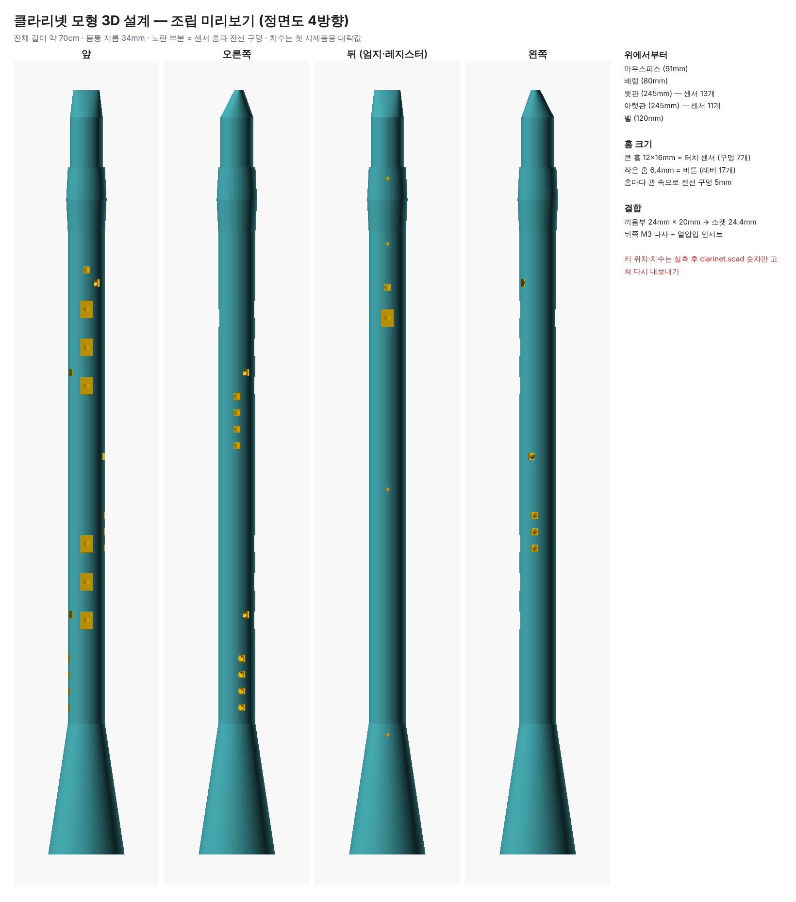

# 클라리넷 모형 3D 설계 (첫 시제품)

키마다 센서를 다는 클라리넷 모형. 실제 클라리넷처럼 **5조각**으로 나눠 Bambu Lab 프린터(X1C·P1S·A1, 출력 크기 약 256mm)에서 조각마다 한 번에 출력한다.



> ⚠ 모든 치수는 **첫 시제품용 대략값**이다. 학생 클라리넷, 실제 터치 모듈·버튼·인서트를 재서 `clarinet.scad` 맨 위 숫자를 고친 뒤 다시 내보낸다.

## 파일

| 파일 | 내용 |
|---|---|
| `clarinet.scad` | 원본 설계 (OpenSCAD). 숫자를 바꾸면 모든 조각이 다시 계산됨 |
| `stl/fit_test.stl` | **결합 시험 조각** — 2개 출력해 서로 끼워 보기 (34×34×45mm) |
| `stl/mouthpiece.stl` | 마우스피스 (30×30×91mm) |
| `stl/barrel.stl` | 배럴 (37×37×80mm) |
| `stl/upper.stl` | 윗관 (34×34×245mm) — 센서 홈 13개 |
| `stl/lower.stl` | 아랫관 (34×34×245mm) — 센서 홈 11개 |
| `stl/bell.stl` | 벨 (70×70×120mm) — 속이 비어 전선 출구, 나중에 Pico 수납 |
| `concept.png` | 조립·배선 개념도 |

STL은 이미 출력 방향으로 놓여 있다: 소켓 쪽(평평한 링)이 바닥, 끼움부가 위. Bambu Studio에 그대로 넣으면 된다.

## 구조

- **몸통**: 바깥 지름 34mm (실제 악기보다 조금 굵게 — 센서 홈 공간), 속에 지름 14mm 전선 통로
- **센서 홈**: 터치 센서 12×16mm·깊이 4mm (구멍 7개), 버튼 6.4×6.4mm·깊이 3.4mm (레버 17개). 홈 바닥마다 관 속으로 지름 5mm 전선 구멍
- **결합**: 위 조각의 끼움부(지름 24, 길이 20mm)가 아래 조각 소켓(지름 24.4mm)으로 들어감. 뒤쪽에서 M3 나사로 고정 — 끼움부에 M3 열압입 인서트(구멍 지름 4.0, 깊이 6mm)
- **키 이름**은 앱의 키 ID(`src/input/keys.js`)와 같다. 위치는 `UPPER_KEYS`, `LOWER_KEYS` 표에서 고친다 (몸통 위 끝에서 거리 mm, 각도: 0 = 앞, 90 = 오른쪽, 180 = 뒤)

## 출력 순서 (권장)

1. **`fit_test.stl` 2개** 먼저 출력 → 서로 끼워 보기
   - 너무 빡빡하면 `fit_gap`을 0.05씩 늘리고, 헐거우면 줄여서 다시 내보내기
2. 맞으면 5조각 출력
3. 끼움부 뒤쪽 구멍에 인두로 M3 인서트를 박고, 조립 후 소켓 쪽 구멍으로 M3 나사 고정

출력 설정은 일반적인 시작값이다 (이 모형으로 시험한 값 아님): PLA, 층 높이 0.2mm, 벽 3겹, 채움 15~20%. 윗관·아랫관은 가늘고 길어서(245mm) **브림(brim)**을 켜는 것을 권장. 센서 홈 윗면은 다리(bridge)로 출력되며 서포트 없이 시험해 보고, 처지면 서포트를 켠다.

## 장바구니에 없는 부품 (추가 필요)

| 부품 | 타오바오 검색어 | 수량 | 용도 |
|---|---|---|---|
| M3 열압입 인서트 | `M3 热熔铜螺母` | 10 | 끼움부에 박는 금속 나사산 (구멍 지름은 상품 설명 값으로 `insert_d` 수정) |
| M3 나사 8mm | `M3 螺丝 8mm` | 10 | 조각 고정 (4곳) |

## 다시 내보내기

```
openscad -D 'part="upper"' -o stl/upper.stl clarinet.scad
```

`part`: `mouthpiece`, `barrel`, `upper`, `lower`, `bell`, `fit_test`, `all`(조립 미리보기, 출력용 아님)

## 아직 확인 못 한 것

- 조각 길이·키 위치가 실제 클라리넷과 맞는지 (학생 악기 실측)
- TTP223 모듈 실제 크기·두께, 버튼 높이 → 홈 크기
- 열압입 인서트 규격 → `insert_d`, `insert_depth`
- 윗관–아랫관 사이 전선을 커넥터로 나눌지 (지름 14mm 통로를 지나가는 커넥터가 필요)
- 실제 프린터 모델 (A1 mini면 245mm 조각이 안 들어감 → 나눠야 함)
